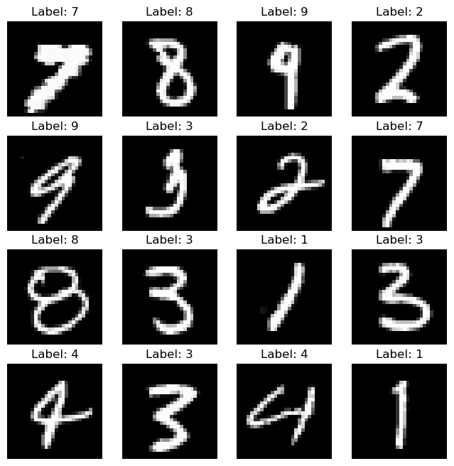
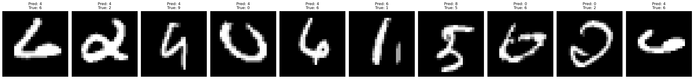

# Reading Handwritten Digits with Neural Networks

**How deep does a neural network need to be to read handwriting, and does adding layers always help?**

The MNIST dataset of 70,000 handwritten digits (60,000 for training and 10,000 for testing), each a 28×28 image, is classified with fully connected neural networks in **TensorFlow/Keras**. Three architectures are compared: one, two and three hidden layers.



## Findings

| Model | Test accuracy |
|---|---|
| One hidden layer | 95.7% |
| Two hidden layers | 96.1% |
| **Three hidden layers** | **96.6%** |

- **Depth helped, a little.** Each extra hidden layer added about half a percentage point. The gains are small and not guaranteed: model improvement does not follow a simple "more layers, better performance" rule, and choosing layer sizes and activations matters as much as depth.
- **Design choices:** each image is flattened into 784 inputs, hidden layers use ReLU (256 neurons in the second layer), and the output layer has 10 softmax neurons, one per digit, giving a probability for each.
- **Where it fails.** The digits the network gets most confidently wrong are often unusually written digits that a person might hesitate over too.

<p align="center"></p>

## How to run

Python with `tensorflow` (which includes Keras), `numpy`, `matplotlib`, `seaborn` and `scikit-learn`. The code downloads MNIST itself.

```bash
pip install tensorflow numpy matplotlib seaborn scikit-learn
python mnist_digit_recognition.py
```

[`mnist_digit_recognition.ipynb`](mnist_digit_recognition.ipynb) is saved with all its outputs, so the results can be read without running anything.

## Tools

Python · TensorFlow · Keras · NumPy · Matplotlib

## Background

Built in July 2024 by **Ido Shalom and Daniel Rodan** during the *Statistical Learning and Data Analysis* course at the Hebrew University of Jerusalem (B.Sc. Statistics & Data Science).
